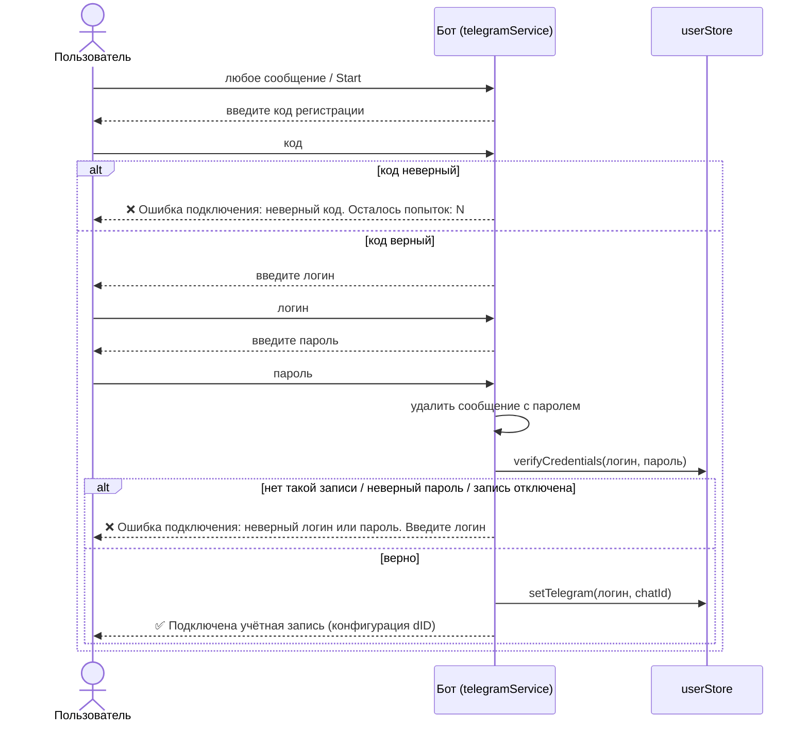
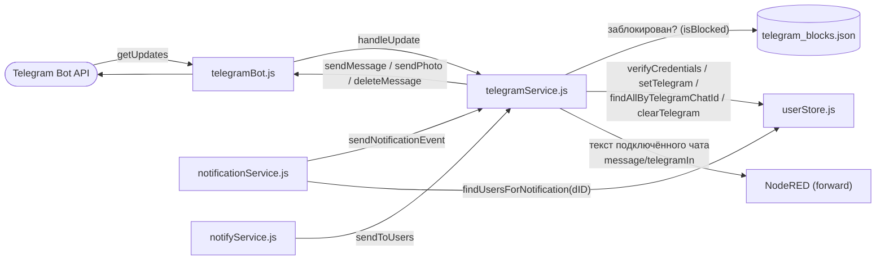
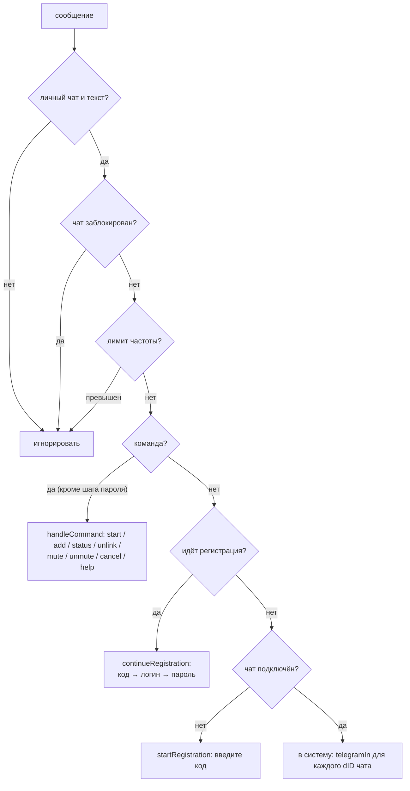

# Telegram-бот: подключение пользователей и рассылка уведомлений

Бот рассылает пользователям **уведомления по условиям** ([notifications.md](notifications.md)) с
каналом «Telegram» или «Веб + Telegram» и оповещения NodeRED. Пользователь один раз подключает свой
чат Telegram к учётной записи сервера. Один чат можно подключить к нескольким учётным записям — тогда
в него приходят уведомления всех их конфигураций (dID).

Содержание:
1. [Создание бота и настройка сервера](#1-создание-бота-и-настройка-сервера)
2. [Подключение пользователя](#2-подключение-пользователя)
3. [Несколько конфигураций в одном чате](#3-несколько-конфигураций-в-одном-чате)
4. [Команды бота](#4-команды-бота)
5. [Как выглядят сообщения](#5-как-выглядят-сообщения)
6. [Ошибки и блокировка](#6-ошибки-и-блокировка)
7. [Устройство кода](#7-устройство-кода)
8. [Если что-то не работает](#8-если-что-то-не-работает)

---

## 1. Создание бота и настройка сервера

1. В Telegram откройте **@BotFather**, отправьте `/newbot`, задайте имя и адрес бота
   (например `poddy_home_bot`). BotFather пришлёт **токен** вида `123456789:AA…`.
2. Придумайте **код регистрации** — его вы будете сообщать тем, кому разрешаете подключаться
   (например `Dom-2026-xK7`). Код общий для всех; поменяли код — старый перестаёт действовать.
   При вводе регистр букв, пробелы и невидимые символы не учитываются (`dom-2026-xk7` тоже подойдёт).
3. В `conf.env` сервера:
   ```bash
   TELEGRAM_ENABLED=true
   TELEGRAM_BOT_TOKEN=123456789:AA…           # токен от BotFather
   TELEGRAM_REGISTRATION_CODE=Dom-2026-xK7    # код регистрации
   ```
   Остальные параметры — по умолчанию (раздел 6 и `conf_example`).
4. Перезапустите сервер. В логе:
   ```
   [telegramService] - запущен, бот @poddy_home_bot; регистрация через бота включена (код регистрации: 12 симв.)
   ```
   Длина кода в логе помогает проверить, что сервер прочитал именно ваш код (сам код в лог не пишется).

Токен и код регистрации — секреты: не публикуйте их и не коммитьте `conf.env`.

Серверу нужен доступ в интернет к `api.telegram.org` (исходящие запросы; входящий порт не нужен —
бот сам опрашивает Telegram).

---

## 2. Подключение пользователя

Пользователь должен уже иметь учётную запись на сервере (логин и пароль от веб-приложения).

1. Найти бота в Telegram по адресу (`@poddy_home_bot`) и нажать **Start** — или написать любое сообщение.
2. Бот: «Для подключения к системе введите код регистрации». Пользователь вводит код.
3. Бот: «Код принят. Введите логин учётной записи». Пользователь вводит логин.
4. Бот: «Введите пароль. Сообщение с паролем будет удалено из чата». Пользователь вводит пароль —
   бот сразу удаляет это сообщение из чата и проверяет логин и пароль.
5. Бот: «✅ Подключена учётная запись **ivan** (конфигурация *igumen*)». Готово — уведомления
   конфигурации igumen с каналом Telegram будут приходить в этот чат.



- На каждом шаге бот ждёт ответа `TELEGRAM_DIALOG_TTL_MS` (10 минут); дольше — регистрация
  начинается заново с кода.
- `/cancel` — прервать регистрацию.
- В шаге пароля сообщение, начинающееся с «/», считается паролем (кроме `/cancel`).

**Второй способ — код из приложения.** Сервер умеет выдавать одноразовый код по запросу
`auth/telegramLinkCode` (в клиенте экрана для этого пока нет). Пользователь отправляет боту
`/start КОД` — чат подключается к его учётной записи без ввода логина и пароля. Код живёт
`TELEGRAM_LINK_TTL_MS` (10 минут). Если `TELEGRAM_REGISTRATION_CODE` пуст, работает только этот способ.

---

## 3. Несколько конфигураций в одном чате

Учётная запись сервера относится к одной конфигурации (dID). Чтобы один человек получал в одном
чате уведомления нескольких конфигураций (дом и дача), чат подключается к **нескольким учётным
записям**:

1. В уже подключённом чате отправить `/add`.
2. Пройти те же шаги: код регистрации → логин → пароль **другой** учётной записи.
3. `/status` покажет все подключённые записи:
   ```
   Подключённые учётные записи:
   • ivan — конфигурация igumen, уровень 2
   • ivan_dacha — конфигурация dacha, уровень 1
   Оповещения: включены
   ```

Правила:
- в каждом сообщении указан dID — видно, из какой конфигурации уведомление;
- если чат подключён к двум записям **одного** dID, сообщение приходит один раз;
- у учётной записи один чат: подключение записи к другому чату заменяет прежний;
- `/unlink ЛОГИН` отключает одну запись, `/unlink` без логина — все;
- `/mute` и `/unmute` действуют на все записи чата.

---

## 4. Команды бота

| Команда | Что делает |
|---|---|
| любое сообщение (чат не подключён), `/start` | начать подключение |
| `/start КОД` | подключение одноразовым кодом из приложения |
| `/add` | подключить ещё одну учётную запись |
| `/status` | подключённые учётные записи, включены ли оповещения |
| `/mute`, `/unmute` | выключить / включить оповещения (для всех записей чата) |
| `/unlink ЛОГИН`, `/unlink` | отключить одну запись / все |
| `/cancel` | прервать подключение |
| `/help` | справка |

Остальной текст из подключённого чата передаётся в систему (NodeRED, `message/telegramIn`) для каждой
конфигурации чата. Управление домом командами из Telegram будет добавлено позже.

---

## 5. Как выглядят сообщения

**Уведомление по условию** (событие — со звуком):
```
🚨 Гостиная · Температура
26.4 °C (условие > 25 °C)
🕒 18.11.2026, 12:12:00 · igumen
```
затем — фото выбранных камер с подписью «Ворота · Гостиная · igumen» (беззвучно).

**Сброс** (беззвучно):
```
✅ Снято: Гостиная · Температура
условие больше не выполняется, сейчас 24 °C
🕒 18.11.2026, 12:40:05 · igumen
```

Время — московское. Получатели — все подключённые пользователи dID уведомления, у которых
оповещения не выключены (`/mute` или настройка профиля).

---

## 6. Ошибки и блокировка

**Ошибка подключения** — неверный код регистрации, неверный логин или пароль (или запись отключена),
недействительный код `/start КОД`. Бот отвечает «❌ Ошибка подключения: … Осталось попыток: N».

После `TELEGRAM_BAD_CODE_LIMIT` (5) ошибок чат **блокируется на сутки**
(`TELEGRAM_BAD_CODE_LOCK_MS`): бот отвечает «⛔ … сообщения из этого чата не принимаются 24 часа» и
дальше молчит — никакие сообщения и команды этого чата не обрабатываются. Блокировка сохраняется в
файле `TELEGRAM_BLOCKS_FILE` (по умолчанию `.configData/telegram_blocks.json`) и действует после
перезапуска сервера. Успешное подключение обнуляет счётчик ошибок.

**Снять блокировку раньше:** удалите запись чата из `telegram_blocks.json` (или весь файл) и
перезапустите сервер.

| Параметр `conf.env` | По умолчанию | Описание |
|---|---|---|
| `TELEGRAM_REGISTRATION_CODE` | пусто | код регистрации; пусто — регистрация через бота выключена |
| `TELEGRAM_BAD_CODE_LIMIT` | `5` | ошибок до блокировки |
| `TELEGRAM_BAD_CODE_LOCK_MS` | `86400000` | срок блокировки (сутки) |
| `TELEGRAM_DIALOG_TTL_MS` | `600000` | ожидание ответа в регистрации |
| `TELEGRAM_BLOCKS_FILE` | `$DATA_DIR/telegram_blocks.json` | файл блокировок |
| `TELEGRAM_RATE_PER_MIN` | `20` | входящих сообщений в минуту с одного чата (лишние игнорируются) |
| `TELEGRAM_LINK_TTL_MS` | `600000` | срок одноразового кода из приложения |

Кроме этого: бот отвечает только в личных чатах (группы игнорируются); недоступный чат (бот
заблокирован пользователем) автоматически отключается от учётной записи при первой неудачной отправке.

---

## 7. Устройство кода

| Файл | Что делает |
|---|---|
| `services/telegramService.js` | диалог регистрации (`startRegistration`, `continueRegistration`), привязка кодом из приложения (`linkByAppCode`), блокировки (`registerFailure`, `isBlocked`, `fileBlockStore`), команды (`handleCommand`), входящие (`handleUpdate`), отправка (`sendNotificationEvent`, `sendToUsers`, `sendPhotosToUsers`, `uniqueChats`), формат (`formatNotificationEvent`) |
| `classes/telegramBot.js` | Bot API: `getUpdates` (long polling), `sendMessage`, `sendPhoto` (multipart), `deleteMessage`, `setMyCommands` |
| `services/userStore.js` | `verifyCredentials`, `setTelegram`, `clearTelegram`, `findAllByTelegramChatId`, `findUsersForNotification` |
| `services/notificationService.js` | уведомления по условиям → `sendNotificationEvent` (канал `telegram` / `both`) |
| `services/notifyService.js` | оповещения NodeRED → `sendToUsers` |
| `services/notifyConfig.js` | параметры `TELEGRAM_*` |



Обработка входящего сообщения (`handleUpdate`):



---

## 8. Если что-то не работает

| Признак | Причина и решение |
|---|---|
| В логе `Telegram отключён` | `TELEGRAM_ENABLED=true` и задан `TELEGRAM_BOT_TOKEN` |
| `[telegramService] - start: … 401 Unauthorized` | неверный токен — скопируйте заново у @BotFather |
| `start: … NETWORK` / timeout | нет доступа к `api.telegram.org` с сервера (интернет, прокси, файрвол) |
| Бот отвечает «Чат не подключён. Получите код в приложении…» | не задан `TELEGRAM_REGISTRATION_CODE` — регистрация через бота выключена |
| «Ошибка подключения: неверный код», хотя код правильный | в логе строка `неверный код регистрации (введено N симв., ожидается M …)`: разная длина — в `conf.env` другой код, лишние кавычки внутри значения или переменная перекрыта окружением терминала (`переменные окружения терминала перекрывают conf.env` при старте). После правки `conf.env` перезапустите сервер |
| Бот не отвечает совсем | чат заблокирован (раздел 6) или превышен лимит сообщений в минуту; проверьте `telegram_blocks.json` |
| «Ошибка подключения: неверный логин или пароль», хотя вход в приложение работает | логин вводится без пробелов; учётная запись может быть отключена администратором |
| Уведомления не приходят | у уведомления канал «Веб» (нужен «Telegram» или «Веб + Telegram»); чат подключён к записи другого dID (`/status`); оповещения выключены (`/unmute`) |
| Приходит только текст, без фото | у камеры не было кадра в момент события, или камера не видна dID уведомления |
